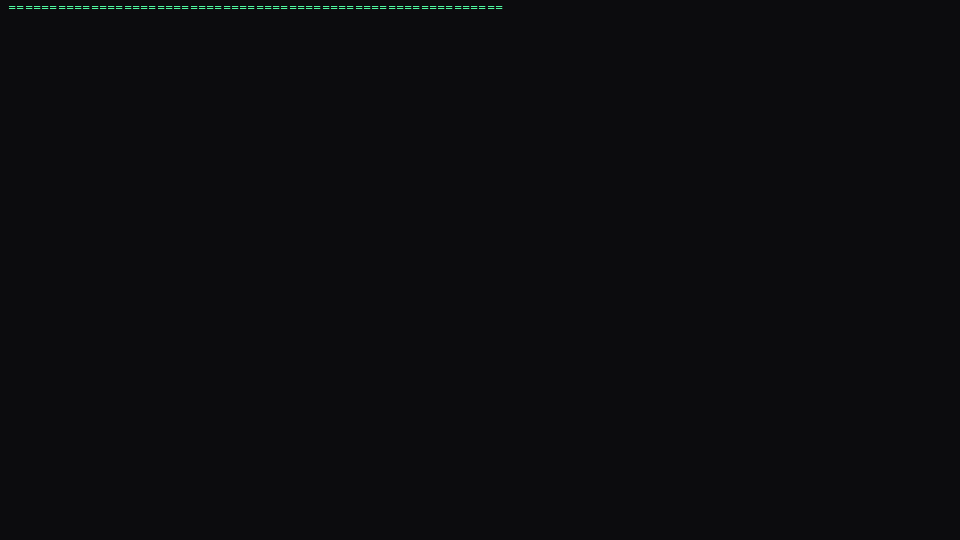

# Malbolge Opera Solver



**Malbolge Opera Solver** — búsqueda, normalización y verificación multi-backend de programas Malbolge.

Autor: **Danny Banks** · Licencia: MIT

---

## Qué es

Un framework para:

- **Buscar** programas Malbolge con múltiples estrategias (exhaustiva, simulated annealing, meta-search, ablación)
- **Verificar** contra múltiples backends (bolge19, malbolge-oracle, Walbolge, Autobolge)
- **Normalizar** cintas Malbolge a mnemónicos legibles con anclas SHA-256
- **Benchmarking** cross-arquitectura (3^10 vs 3^19)

## Quick Start

```bash
# Pipeline completo (exhaustive + SA + meta + ablative)
py test_pipeline_final.py

# Verificar un espécimen
py -c "from opera.evaluator import UnifiedEvaluator; from pathlib import Path; r = UnifiedEvaluator().evaluate_all(Path('specimen.mal')); print({k: v.stdout for k, v in r.items()})"
```

## Arquitectura

```
opera/
├── dsl.py              # OperaScript parser
├── evaluator.py        # Multi-backend unified evaluator
├── objectives.py       # Multi-objective fitness
├── search/
│   ├── exhaustive.py   # Exhaustive search
│   ├── sa.py           # Simulated Annealing
│   ├── meta.py         # Meta search
│   └── ablative.py     # Ablative minimization
├── verify/
│   ├── walbolge.py     # Roundtrip verification
│   └── autobolge.py    # BOLG1/BOLG2 containers
└── cli.py              # CLI entry point
```

## Backends soportados

| Backend | Modelo | Rol |
|---------|--------|-----|
| `bolge19` | 3^19 Unshackled | VM nativo (Zig) para MalbolgeLISP |
| `fast20_fixed` | 3^19 | Parche mprotect sobre fast20 upstream |
| `malbolge-oracle` | 3^10 | Control de referencia Python |
| `Autobolge` | 3^10 | Contenedor BOLG1/BOLG2 (Zig) |
| `Walbolge` | 3^10 | Decompilador inverso del Translator |

### Atribución

Este proyecto es trabajo original de **Danny Banks** dentro de
**ISyCo (Interactive System for Coevolution)**.

Los backends referenciados (bolge19, fast20, Walbolge, Autobolge,
malbolge-oracle) pertenecen al workspace ISyCo y a sus autores respectivos.
MalbolgeLISP y fast20 son obra CC0 de su autor upstream.

## Licencia

MIT — ver `LICENSE`.
