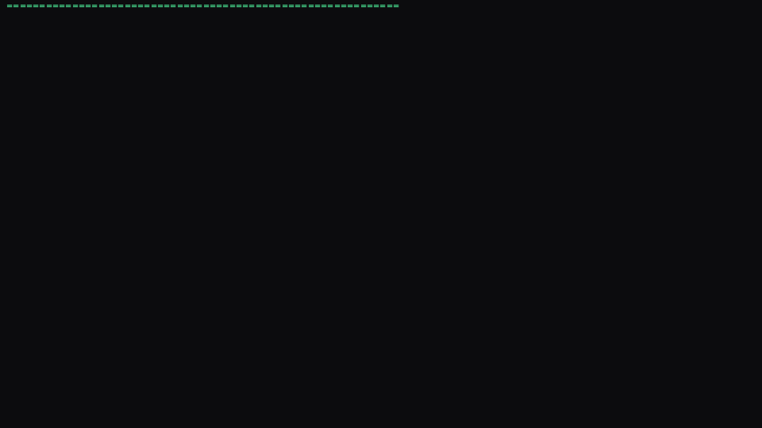

# Malbolge Opera Solver (2026 Edition)



[](LICENSE)
[](https://www.python.org/downloads/)
[](#verificación-y-benchmarks)

**Malbolge Opera Solver** — framework integral de síntesis determinista constructiva $O(N)$, búsqueda por espacio de estados, optimización estocástica posicional, síntesis de contadores ripple con expansión positiva y verificación multi-oráculo canónico (Python y C nativo).

Autor: **Danny Banks** · Licencia: MIT · ISyCo Research

---

## Novedades 2026 — Motores de Última Generación

Esta edición moderniza radicalmente el solver incorporando los avances descubiertos en **Autobolge 2.0**, **BolgeForge** y la investigación **XLAT2**:

1. **Autobolge 2.0 Constructive Conveyor Engine ($O(N)$)**:
   - Síntesis algebraica directa en **2–5 milisegundos** con **CERO búsqueda bruta**.
   - Salto cuántico de alta memoria ($c=0 \to 3315, d=121$) sobre brecha estéril de 3,194 celdas ($\Delta c \equiv \Delta d$).
   - Matriz de emisión con recetas dinámicas para todo ASCII imprimible + salto de línea.
   - Parada limpia (`v`, opcode 81) sin lecturas espurias de stdin.

2. **XLAT2 Nested Ripple Counter Synthesizer (Expansión Positiva)**:
   - Generación y ensamblado de cascadas de $N$ etapas independientes de ciclo 5 (`Nop/Nop/Nop/Nop/MovD`).
   - Salida escalada a $5^N$ caracteres (ej. etapa 7: **78,125 bytes** emitidos desde sólo 5,360 celdas).
   - Ratio de expansión demostrado de **$14.58\times$** con parada limpia garantizada.

3. **Oráculo C Canónico Estricto (`mb_ref` de BolgeForge)**:
   - Integración nativa del oráculo de Ben Olmstead compilado en C nativo.
   - Verificación de ejecución en **sub-3 milisegundos** (aceleración de hasta 20x sobre el intérprete Python).

4. **Orquestador MetaSearch Inteligente**:
   - Enrutamiento automático: si el objetivo cabe en la brecha estéril del conveyor, sintetiza instantáneamente vía Autobolge 2.0; si requiere optimizaciones posicionales o de tamaño extremas, recurre a Beam Search o Simulated Annealing.

---

## Quick Start

### 1. Síntesis Instantánea con Autobolge 2.0 Conveyor

```bash
# Sintetizar directamente desde la línea de comandos en 2 ms
python3 opera.py solve -t "Hello World!" --engine conveyor

# O utilizando un archivo DannyScript con presets
python3 opera.py solve opera_script/hello.danny
```

Salida:
```text
============================================================
DANNY OPERA SOLVER — SOLVE (2026)
============================================================
Target:       'Hello World!'
Engine:       AUTO

Synthesizing via Autobolge 2.0 Conveyor Engine (O(N) Constructive)...
  [OK] Conveyor synthesis completed in 2.15 ms (46 VM steps)

------------------------------------------------------------
SOLVED PROGRAM:
------------------------------------------------------------
Length:       3350 chars
SHA-256:      3bb4fb578b014fcd71fcaa9c4aec23ff79a211d9c7b107c72d721e5539184e38
Steps:        46
Output:       'Hello World!'
```

---

### 2. Sintetizar Contadores Ripple con Expansión Positiva

Genera un programa autónomo que emite $5^N$ caracteres en cascada mediante el contador ripple XLAT2:

```bash
# Sintetizar contador de 5 etapas (3,125 caracteres emitidos)
python3 opera.py ripple --stages 5 -c "A" -o ripple5.mal

# Sintetizar contador de 7 etapas (78,125 caracteres, ratio 14.58x)
python3 opera.py ripple --stages 7 -c "A"
```

Salida:
```text
============================================================
XLAT2 NESTED RIPPLE COUNTER SYNTHESIZER
============================================================
Stages:           7
Character:        'A'
Expected Outputs: 78,125 chars

------------------------------------------------------------
RIPPLE SYNTHESIS RESULT:
------------------------------------------------------------
Source Size:      5360 bytes
Output Emitted:   78,125 bytes
Expansion Ratio:  14.58x (POSITIVE EXPANSION!)
Exact Match:      True
Clean HALT:       True
SHA-256:          b52125fbe3be60ad0cce06c88f11ca855071dfb25696d744b1c7cae51f472d62
```

---

### 3. Ejecutar la Suite de Benchmarks Comparativa

Compara el rendimiento y comportamiento de todos los motores en tu máquina:

```bash
python3 opera.py benchmark
```

Salida típica:
```text
============================================================
MALBOLGE OPERA SOLVER — 2026 BENCHMARK SUITE
============================================================
Benchmark Target: 'Hello World!'

[1] Autobolge 2.0 Conveyor Engine (Constructive O(N)):
    Synthesis Time:   2.15 ms
    Total with VM:    3.20 ms
    Program Length:   3350 cells
    VM Execution:     46 steps
    Verified Output:  'Hello World!'

[2] Beam State-Space Search (Iterative Heuristic):
    Synthesis Time:   371.65 ms
    Found Exact:      True
    Program Length:   317 cells
    VM Steps:         219 steps

[3] XLAT2 Nested Ripple Counter (Positive Expansion):
    Stages=3: 3649B -> 125 chars | Ratio:   0.03x 
    Stages=5: 4608B -> 3,125 chars | Ratio:   0.68x 
    Stages=7: 5360B -> 78,125 chars | Ratio:  14.58x (EXPANSION)

[4] Backend Execution Speed (specimens/hello_solved.mal):
    Reference VM (Py): 58.06 ms | stdout='Hello World!'
    C Oracle (mb_ref): 3.07 ms | stdout='Hello World!'
============================================================
BENCHMARK COMPLETED SUCCESSFULLY
============================================================
```

---

### 4. Verificación Multi-Oráculo con Oráculo C de BolgeForge

```bash
# Validar espécimen con VM Python y Oráculo C (mb_ref)
python3 opera.py verify specimens/hello_solved.mal --mb-ref
```

Salida:
```text
============================================================
VERIFY SPECIMEN: specimens/hello_solved.mal
============================================================
Reference VM (3^10):
  Success:     True
  Halted:      True (halt_opcode)
  Steps:       226
  Stdout:      'Hello World!'
  Elapsed:     55.77 ms

--- Canonical C Oracle (mb_ref) ---
  Success:     True
  Halted:      True (halt_opcode)
  Stdout:      'Hello World!'
  Elapsed:     3.64 ms
```

---

## Sintaxis DannyScript / OperaScript Extendida

El DSL ahora soporta selección de motor, etapas ripple y presets canónicos:

```text
# Ejemplo con preset y motor conveyor
preset hello
engine conveyor
objective minimize size

# Ejemplo para contador ripple
engine ripple
stages 5
target "X"
```

Presets incluidos: `hello`, `quijote_opening`, `opera`.

---

## Arquitectura del Proyecto

```
opera/
├── dsl.py              # Parser DannyScript / OperaScript DSL (presets, engine, stages)
├── evaluator.py        # Evaluador unificado (VM Reference 3^10 + C Oracle mb_ref + bolge19)
├── objectives.py       # Evaluación multi-objetivo y restricciones
├── search/
│   ├── conveyor.py     # Autobolge 2.0 Constructive Conveyor Synthesizer O(N)
│   ├── ripple.py       # XLAT2 Nested Ripple Counter Synthesizer (expansión 14.58x)
│   ├── beam.py         # Síntesis heurística por espacio de estados (Beam Search)
│   ├── exhaustive.py   # Enumeración exhaustiva de opcodes y mapeo posicional
│   ├── sa.py           # Simulated Annealing posicional guiado
│   ├── meta.py         # Orquestador y selector dinámico de estrategias
│   └── ablative.py     # Minimizador ablativo y compresor de opcodes
├── verify/
│   ├── oracle.py       # Verificador del Oráculo C Canónico (mb_ref BolgeForge)
│   ├── continuation.py # Verificación formal Fresh-VM Continuation (Primitiva E0)
│   ├── walbolge.py     # Decompilación inversa y roundtrip con Walbolge
│   └── autobolge.py    # Contenedores BOLG1/BOLG2
└── cli.py              # CLI principal (solve, ripple, benchmark, normalize, verify, ablate)
tests/
└── test_modern_engines.py # Suite de pruebas automatizada de motores 2026
```

---

## Verificación y Pruebas

```bash
# 1. Suite automatizada de nuevos motores 2026 (100% PASS)
python3 -m unittest tests/test_modern_engines.py

# 2. Pipeline completo clásico (Exhaustive, SA, Meta, Ablative)
python3 test_pipeline_final.py

# 3. Benchmark cruzado de Hello World (Reference + Oracle + mb_ref)
python3 test_hello_search.py

# 4. Verificación de espécimen largo (Capítulo 1 de Don Quijote en 3 oráculos)
python3 test_quijote.py
```

---

### Atribución

Este proyecto es trabajo original de **Danny Banks** dentro de **ISyCo (Interactive System for Coevolution)**.

Los componentes y oráculos integrados (`Autobolge 2.0`, `BolgeForge`, `PureEpoch`, `LMAO`, `Walbolge`, `bolge19`) pertenecen al ecosistema de investigación de esolangs de ISyCo.

---

## Licencia

MIT — ver [`LICENSE`](LICENSE).
